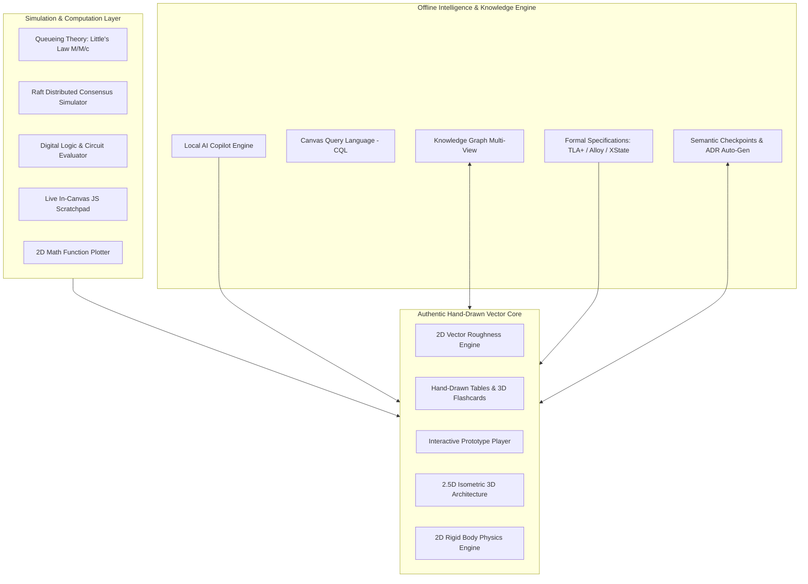
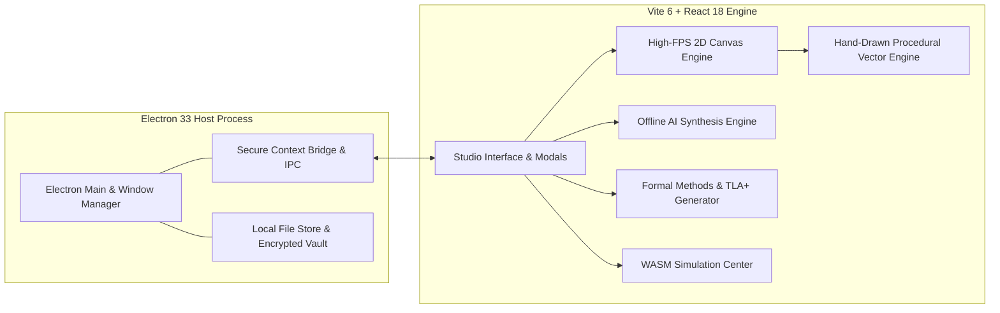

<p align="center">
  <a href="#doodle-desk">
    
  </a>
</p>

<h1 align="center">Doodle Desk</h1>

<p align="center">
  <b>The offline-first visual thinking operating system for software architects, systems engineers, educators, and creators.</b>
  <br />
  Combines hand-drawn sketching with local-first AI synthesis, executable specifications, formal method verification, queueing & consensus simulation, computable knowledge graphs, and interactive tables.
</p>

<p align="center">
  
  
  
  
  
  
  
</p>

<p align="center">
  
</p>

<p align="center">
  <a href="#-why-doodle-desk"><b>Why Doodle Desk</b></a> •
  <a href="#-next-gen-strategic-features"><b>Next-Gen Features</b></a> •
  <a href="#-local-first-ai-copilot"><b>Offline AI Copilot</b></a> •
  <a href="#-executable-formal-specifications"><b>Formal Specs</b></a> •
  <a href="#-simulation-center"><b>Simulators</b></a> •
  <a href="#-knowledge-graph--cql"><b>Knowledge Graph & CQL</b></a> •
  <a href="#-powerhouse-canvas-tools"><b>Powerhouse Tools</b></a> •
  <a href="#-keyboard-shortcuts"><b>Shortcuts</b></a> •
  <a href="#-tech-stack"><b>Architecture</b></a> •
  <a href="#-quick-start"><b>Quick Start</b></a>
</p>

---

## 🌟 Why Doodle Desk?

Most whiteboards are passive, browser-locked canvases that treat diagrams as static pictures and tether your intellectual property to external cloud databases.

**Doodle Desk is an executable, programmable visual thinking workspace.**
- **100% Offline-Native:** Zero cloud dependencies, zero telemetry, zero accounts. Starts in sub-second time directly from your local filesystem.
- **Diagrams That Run:** Don't just draw architectures—simulate them. Test Little's Law with queueing models, verify Raft leader elections, step through statecharts, and evaluate digital logic circuits.
- **Architectural Brain:** Turn visual flows into formal **TLA+** and **Alloy** specs, **XState v5** state machines, or **Markdown ADRs** (Architecture Decision Records) with one click.
- **Universal Local AI:** Synthesize complete system blueprints from natural language prompts offline, review architecture for single points of failure, and lint diagrams with zero cloud pings.

---

## 🚀 Next-Gen Strategic Features (v1.2+)



---

### 🧠 1. Local-First AI Copilot ("Offline Cursor")
*The first fully offline AI architecture companion built into a desktop whiteboard.*

- **Universal Prompt-to-Diagram Synthesizer:** Type any prompt to instantiate a complete, multi-tier architecture diagram positioned dynamically right in front of your camera viewport.
  - **16 Deep Domain Blueprints:** AI & LLM Inference pipelines (RAG, Vector DB, Guardrails), E-Commerce Checkout flows, Realtime Logistics & Fleet Dispatch, Video Transcoding & HLS Streaming (Netflix/YouTube), Healthcare Clinical EHR workflows, Decentralized Blockchain & Web3 smart contracts, Banking & Realtime Fraud Detection, Social Feed Two-Tower Rankers, IoT Telemetry & MQTT, Science & Solar Power Grids, DevOps CI/CD Pipelines, Kafka/Flink Streaming ETL, Serverless Cloud, OAuth2/JWT Auth, Microservices Meshes, and Multiplayer Matchmaking.
  - **Universal Dynamic Synthesizer:** For any arbitrary or creative topic (*e.g. "quantum computing error stabilizer"*, *"space rover satellite communications"*, or *"sourdough bread fermentation"*), the engine dynamically abstracts input triggers, ingress protocols, logic engines, decision policies, and persistent audit stores into a framed 6-stage architecture.
- **Architectural Explainer:** Select elements or frames and generate narrative Markdown architectural walkthroughs.
- **Architecture Reviewer:** Inspect systems for single points of failure (SPOF), circular dependencies, and high-coupling risks.
- **Diagram Linter:** Automatically detect orphan components, unlabelled directional arrows, and dangling decision diamond outcomes.
- **Auto-Flashcards:** Scan table datasets and canvas elements to create study decks with one click.
- **Access Points:** Command Palette (`Ctrl+K` → *"Local AI Copilot"*), global hotkey (`Ctrl+Shift+A`), or Canvas Tools Menu.

---

### 🧪 2. Executable Specification Canvas (Formal Methods Made Visual)
*Bring the rigor of formal methods to visual diagramming.*

- **State Machine to Formal Code:** Draw states and labeled transitions, then automatically generate:
  - **TLA+ Specifications:** Complete formal models defining invariants, actions, and temporal properties (`MODULE CanvasProtocol EXTENDS Naturals, TLC`).
  - **Alloy Models:** Relational logic specifications with signatures and transition predicates (`sig State {} pred step`).
  - **XState v5 Configs:** Production-ready JavaScript state machine definitions ready to paste into React or Node.js applications.
- **Interactive Visual Step Debugger:** Replay execution pathways step-by-step. The active state and connecting arrow highlight directly on the canvas as you step forward, reverse, or play automated traces at variable intervals.
- **Export & Copy:** 1-click download of `.tla`, `.als`, and `.js` spec files.

---

### 🎮 3. Executable Simulation Center (Mental Models in Action)
*Turn static blueprints into running systems.*

- **Queueing Theory Simulator (Little's Law):**
  - Configure arrival rates ($\lambda$), service rates ($\mu$), and parallel servers ($c$).
  - Calculate real-time utilization ($\rho$), FIFO buffer wait times ($W_q$), total system latency ($W$), and in-flight inventory ($L = \lambda W$).
  - 1-click stamp of visual queueing station topologies directly onto your canvas.
- **Raft Distributed Consensus Visualizer:**
  - Simulate distributed clusters with automated leader election, heartbeats, and log replication.
  - Simulate node crashes (Kill) and network partition recoveries (Revive) to watch split-brain protection in action.
- **Digital Logic & Circuit Simulator:**
  - Interactive gate evaluation for `AND`, `OR`, `NOT`, `NAND`, `NOR`, `XOR`, and `XNOR`.
  - Toggle live input pins (`A`, `B`) and inspect output signals and dynamic truth tables.
  - Stamp complete logic circuits directly into hand-drawn vector elements on the canvas.

---

### 🔍 4. Knowledge Graph Brain & Canvas Query Language (CQL)
*The whiteboard as an active, queryable knowledge base.*

- **Spotlight CQL Query Bar (`Ctrl+Shift+F`):**
  - Instant spotlight search with expressive query syntax: `SHOW frames`, `SHOW components WHERE type="cylinder"`, `SHOW nodes CONNECTED_TO "api"`, or search by free text.
  - Quick-action preset chips and instant batch selection of matching components.
- **Knowledge Graph Multi-View (`CanvasMultiViewModal`):**
  - **Entity Table View:** Computable table listing in-degree, out-degree, type, status, and frame ownership with 1-click canvas locating.
  - **Sugiyama DAG Hierarchy:** Visualizes topological dependency trees and outgoing connection counts.
  - **Kanban Workflow View:** Automatically categorizes canvas components into *Backlog*, *In Progress*, *Decisions*, and *Completed* columns.
  - **Quality Rules Engine:** Real-time architectural auditing highlighting missing labels, critical violations, and orphan nodes.

---

### 🕒 5. Semantic Time-Travel & ADR Generation
*Architectural versioning that understands structure, not just pixels.*

- **Named Milestones:** Save named checkpoints (*e.g. "Initial Monolith"*, *"Microservices Refactor"*, *"Pre-Audit Freeze"*).
- **Structural Semantic Diffs:** Compare any two milestones to see added, modified, and deleted architectural entities.
- **Automated ADR Generation:** Instantly compile structural diffs into professional **Architecture Decision Records (ADR)** in Markdown format with YAML frontmatter, context, decision consequences, and component manifests.
- **Instant Rollback:** Restore complete board state to any previous milestone with one click.

---

### 🎯 6. Persona Focus Modes
*One app tailored into 5 specialized working environments.*

| Persona | Canvas Style | Optimized Toolset | Primary Hotkeys |
|---|---|---|---|
| **Architect** | Blueprint Grid | Frames, decision diamonds, cylinders, auto-layout | `Shift+A` (AutoLayout), `Ctrl+Shift+F` (CQL) |
| **Teacher** | Warm Parchment | Tables, flashcards, whiteboard animation, sticky notes | `Space` (Flip), `Shift+P` (Presentation) |
| **Developer** | Engineering Dark | JS scratchpad, math graph, terminal card, formal specs | `Ctrl+K` (Command), `Ctrl+Shift+A` (AI) |
| **Designer** | Standard White | Color palette studio, laser pointer, prototype player | `Alt+P` (Prototype), `K` (Laser) |
| **Researcher** | Dot Grid | Knowledge graph, PDF cards, CQL query bar, mind maps | `Ctrl+Shift+F` (CQL), `Shift+T` (Time Machine) |

---

### 🔌 7. WASM Plugin Ecosystem & Sandboxed Extensions
*An extensible, local-first platform architecture.*

- **Plugin Directory:** Manage offline WebAssembly extensions under `~/Doodle Desk/plugins/`.
- **WASM Isolation:** Plugins execute in strictly memory-isolated WebAssembly runtimes with zero ambient network access.
- **Plugin Catalog:** Toggle installed plugins on/off instantly via the Plugins Manager.
- **Developer Scaffolding:** 1-click export of plugin manifest templates (`manifest.json`) for custom shape renderers, simulators, and exporters.

---

### ☁️ 8. Local-First Sync & User-Owned Infrastructure
*Zero-telemetry infrastructure built for privacy-critical teams.*

- **Syncthing Integration:** Peer-to-peer workspace folder synchronization across devices using end-to-end TLS.
- **WebDAV / Nextcloud:** Direct synchronization with self-hosted Nextcloud, ownCloud, or generic WebDAV endpoints.
- **MinIO / S3 Archival:** Push diagram snapshots directly to private S3-compatible object storage clusters.
- **Git Repositories:** Map canvas files deterministically into local Git working repositories.
- **Encrypted Portability:** Export zero-knowledge encrypted backups (`.doodleenc`) scrambled with user passphrases for tamper-proof archival.

---

## 🎨 Powerhouse Canvas Tools

### 📊 Hand-Drawn Interactive Tables & 3D Flashcards
- **Native Hand-Drawn Tables:** Organic borders, double-underlined header dividers, and flexible grid cells that look hand-sketched.
- **In-Cell Editing:** Smooth inline typing with keyboard navigation (`Tab`, `Shift+Tab`, `Enter`).
- **3D Study Flashcards:** Instantly flip any table into an interactive 3D study deck. Pick Question and Answer columns, navigate with arrow keys or `Space` to flip, track *Got It!* vs *Still Learning*, and shuffle cards.

### 💻 Executable JavaScript Scratchpad Cards
- **Sandboxed Offline Engine:** Write and evaluate JavaScript directly on your whiteboard canvas.
- **Live Output Stream:** Inspect return values, execution duration benchmarks, and captured `console.log` logs.
- **Stamp to Canvas:** Turn code evaluations into permanent vector text elements with a single click.

### 📐 Math & 2D Function Plotter Cards
- **Real-Time Function Curve Plotter:** Graph curves like `a * sin(b * x)`, quadratics, polynomials, and exponentials.
- **Parameter Sliders:** Drag parameters `a`, `b`, `c` to see curves deform in real time.
- **Stamp Curve:** Convert graphed curves directly into native vector freehand strokes.

### 📱 Interactive Prototype Player
- **Clickable Screen Walkthroughs:** Connect shapes and frames using prototype links to build interactive application mockups.
- **Live Player Modal (`Alt+P`):** Experience clickable screen-to-screen transitions, start-screen selection, and interactive device frames.

### 🧊 2.5D Isometric 3D Architecture View
- **Depth Extrusion:** Transform 2D system architecture diagrams into layered 2.5D isometric perspectives.
- **Camera Presets:** Switch between Top-Down, Isometric Angle, and Layer Stratification views with interactive elevation sliders.

### 🪐 2D Physics Playground
- **Rigid Body Dynamics:** Turn rectangles, circles, and diamonds into physical bodies subject to gravity, restitution, and collisions.
- **Interactive Forces:** Toss and bounce shapes with realistic physics simulation.

### 🎵 Ambient Sound Studio
- **Generative Soundscapes:** Listen to soothing offline procedural audio (Rain, Forest Birds, Coffee Shop, White Noise).
- **Integrated Pomodoro Timer:** Keep focused with customizable work and break intervals.

---

## 🔄 Universal Schema Interoperability

Doodle Desk connects directly into standard engineering formats:

### Import Sources
| Format | Description |
|---|---|
| **OpenAPI / Swagger** | Generates REST API service cards, endpoints, and method badges |
| **GraphQL SDL** | Parses schemas into types, queries, and interconnected relation nodes |
| **SQL DDL** | Converts database tables and foreign keys into entity-relationship diagrams |
| **Terraform HCL** | Renders cloud infrastructure resources and provider blocks |

### Export Targets
| Target | Description | Output |
|---|---|---|
| **Mermaid.js** | Flowcharts and sequence diagrams | Markdown/Plaintext |
| **PlantUML** | Architecture components and state diagrams | `.puml` |
| **C4 Model** | Context, Container, and Component diagrams | Structurizr/C4 |
| **Architecture Decision Record** | Complete Markdown ADR with context & consequences | `.md` |
| **Wireframe to React** | Clean React components styled with Tailwind CSS | `.jsx` / `.html` |
| **Vector & Document** | Scalable vector graphics and raster prints | `.svg`, `.png`, `.pdf`, `.doodle` |

---

## ⌨️ Comprehensive Keyboard Shortcuts

### Navigation & Canvas
| Shortcut | Action |
|---|---|
| `Space + Drag` / `Middle Click` | Smooth canvas panning |
| `Ctrl + Scroll` | Zoom in / Zoom out |
| `Ctrl + 0` | Reset zoom to 100% |
| `Ctrl + +` / `Ctrl + -` | Increment / decrement zoom |
| `Shift + F` | Toggle Spotlight Focus Mode |
| `Shift + T` | Canvas Time Machine |
| `Ctrl + Alt + P` | Presentation Mode |
| `Alt + P` | Interactive Prototype Player |
| `Ctrl + Shift + F` | Canvas Query Language (CQL) Bar |
| `Ctrl + Shift + A` | Local AI Copilot |
| `Ctrl + K` | Universal Command Palette |

### Drawing & Tool Selection
| Key | Tool |
|---|---|
| `1` or `V` | Selection Pointer |
| `2` or `R` | Rectangle |
| `3` or `D` | Diamond (Decision Node) |
| `4` or `O` | Ellipse |
| `5` or `A` | Directional Arrow Connector |
| `6` or `L` | Straight Line |
| `7` or `P` | Freehand Pencil |
| `8` or `T` | Handwritten Text |
| `9` or `E` | Eraser |
| `0` or `H` | Laser Pointer |
| `F` | Container Frame |

### Element Manipulation
| Shortcut | Action |
|---|---|
| `Ctrl + C` / `Ctrl + V` | Copy / Paste elements |
| `Ctrl + D` | Duplicate selection |
| `Alt + Drag` | Clone and drag element |
| `Alt + Resize` | Symmetrical center-point resize |
| `Shift + Draw` | Constrain 1:1 aspect ratio or 15° connector snap |
| `Shift + Drag` | Constrain movement to strict horizontal/vertical axis |
| `Ctrl + ]` / `Ctrl + [` | Bring to front / Send to back |
| `Ctrl + G` / `Ctrl + Shift + G` | Group / Ungroup selection |
| `Delete` / `Backspace` | Delete selected elements |

---

## 🛠️ Architecture & Tech Stack



- **Runtime & Desktop Shell:** [Electron 33](https://www.electronjs.org/) (Secure preload IPC bridge, context isolation, frameless native title bar).
- **Frontend Architecture:** [React 18](https://react.dev/) + [Vite 6](https://vitejs.dev/) with code splitting and lazy-loaded modal bundles.
- **Canvas Pipeline:** Custom high-performance 2D Canvas engine with spatial indexing, occlusion culling, and requestAnimationFrame rendering.
- **Procedural Aesthetics:** Custom hand-drawn math engine generating organic roughness, line overshoots, and multi-angle hachure fills.
- **Simulation Layer:** Offline mathematical modeling engines for Little's Law queueing, Raft consensus protocol, and digital logic gates.
- **Persistence:** [electron-store](https://github.com/sindresorhus/electron-store) for settings and loss-less `.doodle` JSON schemas with automated crash-recovery snapshotting.
- **Icons & Styling:** [Lucide React](https://lucide.dev/) paired with a unified CSS token architecture supporting dark and light studio themes.
- **Testing:** [Vitest](https://vitest.dev/) (344 unit and integration tests across 59 suites) + [Playwright](https://playwright.dev/) for automated visual and browser verification.
- **Packaging:** [electron-builder](https://www.electron.build/) targeting Windows (NSIS Setup & Portable), macOS (DMG), and Linux (AppImage, DEB, RPM).

---

## 🚀 Quick Start

### Prerequisites
- **Node.js 18+** (Node 20 or 22 LTS recommended)
- **npm 9+**

### Installation

```bash
# 1. Clone the repository
git clone https://github.com/yvvsatyanarayana-dev/Doodle-Desk.git

# 2. Navigate to project root
cd Doodle-Desk

# 3. Install dependencies
npm install
```

### Running in Development

```bash
# Starts Vite dev server + launches Electron desktop shell with hot module replacement
npm run dev
```

---

## 🧪 Testing

Doodle Desk maintains a comprehensive test suite covering canvas rendering, vector math, geometry viewport, file persistence, and interactive embeddables:

```bash
# Run all 344 unit and integration tests (Vitest)
npm test

# Run tests in watch mode
npx vitest

# Run targeted features roadmap tests
npx vitest run tests/featuresRoadmap.test.jsx

# Run end-to-end Electron desktop smoke tests (Playwright)
npm run test:e2e
```

---

## 📦 Packaging & Installers

Generate production-grade standalone installers into the `dist/` and `release/` directories:

```bash
# Package for your current operating system
npm run build

# Windows: Generates NSIS Setup Wizard (.exe) + Portable Executable (.exe)
npm run build:win

# macOS: Generates Apple Disk Image (.dmg) + Universal ZIP (.zip)
npm run build:mac

# Linux: Generates AppImage, Debian (.deb), and RPM (.rpm) packages
npm run build:linux
```

> [!NOTE]
> **Windows Installer Behavior:**
> When uninstalling via the Windows Control Panel, the NSIS uninstaller prompts whether to back up your Doodle Vault and preferences. Backups are preserved under `%LOCALAPPDATA%\Doodle Desk Uninstall Backups` to protect against accidental data loss.

---

## 🔒 Offline & Privacy Guarantee

- **100% Offline by Default:** Zero tracking, zero telemetry, and zero remote server pings. Your boards, code snippets, and AI-synthesized architectures never leave your local machine.
- **Strict Content Security Policy (CSP):** Disallows remote scripts, insecure eval execution, and unauthorized network connections.
- **Full Data Ownership:** All diagrams are saved in standard, human-readable JSON (`.doodle`) or exported to standard image and document formats (`.png`, `.svg`, `.pdf`).

---

## 📜 License & Free Lifetime Commitment

This project is open-source and licensed under the [MIT License](LICENSE).

Copyright (c) 2026 Satyanarayana.

**Doodle Desk** is built and maintained as a **100% free lifetime resource for students, teachers, creators, and developers worldwide**. No subscriptions, no paywalls, and no hidden telemetry — forever.
