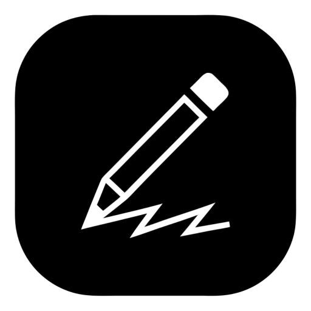
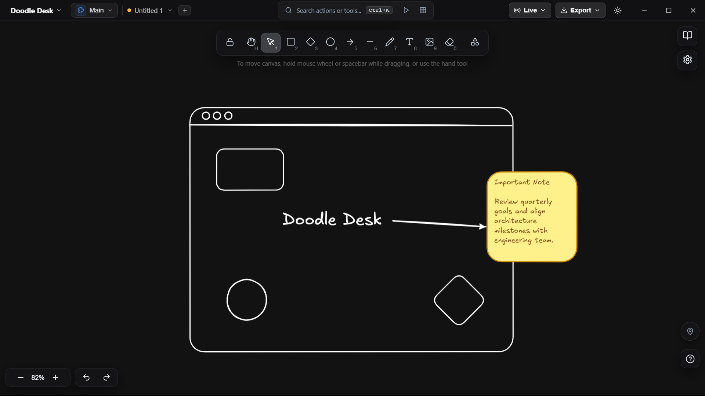
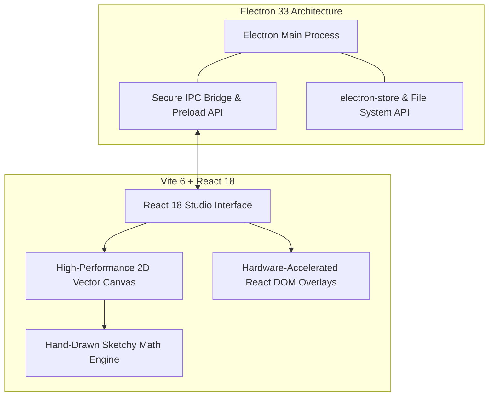

<p align="center">
  <a href="#doodle-desk">
    
  </a>
</p>

<h1 align="center">Doodle Desk</h1>

<p align="center">
  <b>A production-grade, offline desktop whiteboard for sketching hand-drawn diagrams, code, math, and interactive tables.</b>
  <br />
  Fast, privacy-focused, zero-cloud dependency, and 100% free for a lifetime.
</p>

<p align="center">
  
  
  
  
  
  
</p>

<p align="center">
  
</p>

<p align="center">
  <a href="#-key-features"><b>Key Features</b></a> •
  <a href="#-powerhouse-tools"><b>Powerhouse Tools</b></a> •
  <a href="#-keyboard-shortcuts"><b>Keyboard Shortcuts</b></a> •
  <a href="#-tech-stack"><b>Tech Stack</b></a> •
  <a href="#-quick-start"><b>Quick Start</b></a> •
  <a href="#-packaging--installers"><b>Packaging</b></a> •
  <a href="#-offline--privacy-guarantee"><b>Privacy</b></a>
</p>

---

## 📖 Overview

**Doodle Desk** is an offline-first desktop application designed for software architects, engineers, educators, and creators who value the simplicity of hand-drawn whiteboards combined with the power of modern desktop productivity. 

Unlike conventional browser-based whiteboards, Doodle Desk runs entirely locally on your machine with zero telemetry, zero server dependencies, and immediate responsiveness. From system architecture diagrams and flowcharts to executable JavaScript scratchpads, 2D function plotters, and hand-drawn interactive tables, Doodle Desk gives you a studio canvas that adapts to your creative and technical thinking.

---

## 🎨 Key Features

### 🖌️ Native Hand-Drawn Vector Engine
- **Authentic Sketchy Aesthetics:** Roughness, organic wobbles, and line overshoots inspired by classic whiteboard sketching.
- **Rich Vector Shapes:** Rectangles, diamonds, ellipses, freehand brush strokes, linear arrows, curved connectors, frames, and text boxes.
- **Versatile Fills:** Solid, hachure, and cross-hatch hand-drawn shading styles.
- **Handwritten Typography:** Native handwritten typography stacks featuring Doodlefont, Virgil, and monospace options.
- **Canvas Paper Styles:** Switch seamlessly between **Standard Whiteboard**, **Blueprint Grid**, **Dot Grid**, **Isometric Grid**, **Engineering Dark**, and **Warm Parchment** backgrounds.
- **Smart Shape Recognition:** Draw rough freehand strokes, and Doodle Desk intelligently converts them into geometric shapes in real-time.

### 📊 Native Hand-Drawn Interactive Tables
- **Table 2 Aesthetic:** Hand-drawn outer rounded rectangles, header dividing lines with overshoot accents, and vertical column dividers matching the native canvas shape style.
- **Pixel-Perfect Scaling:** Column widths and row heights scale proportionally to match hand-drawn vector paths down to the pixel.
- **Frictionless In-Cell Editing:** Smooth inline editing with complete keyboard navigation (`Tab`, `Shift+Tab`, `Enter`).
- **Clean Blank Canvas:** Tables start completely clean with empty headers and blank cells—free from distracting placeholder text.
- **Floating Quick-Action Toolbar:** Neatly positioned above the table with options to add or delete rows and columns, plus right-click context menu support and dedicated drag handles.
- **Hardware-Accelerated Dragging:** Move tables anywhere on the canvas without visual artifacts or canvas drag conflicts.
- **Table Q&A Flashcards Study Mode:** Instantly transform any interactive table into an interactive 3D flip-card study deck. Select one column for Questions and another for Answers with 1-click swapping (`⇄`), keyboard navigation (`Space` to flip, `←`/`→` to navigate, `1` for Still Learning, `2` for Got It!), shuffle deck mode, progress tracking, and authentic hand-drawn sound effects.

### 💻 Executable JavaScript Scratchpad Cards
- **Live In-Canvas Runtime:** Write and run sandboxed offline JavaScript directly on your whiteboard canvas.
- **Console Output Stream:** Inspect returned values, captured `console.log` logs, and execution duration benchmarks.
- **Presets & Snippets:** Instant access to curated algorithm presets, math helpers, and data structure examples.
- **Stamp to Canvas:** Export script output or definitions directly as canvas text elements with one click.
- **Synchronous Drag Synchronization:** Cards move in real-time with selection outlines with zero lag or background clipping.

### 📐 Math & Function Graph Cards
- **Interactive 2D Function Plotter:** Plot single-variable mathematical functions (e.g. `a * sin(b * x)`, quadratics, polynomials, exponentials) in real-time.
- **Dynamic Parameter Sliders:** Tune parameters (`a`, `b`, `c`) with responsive sliders to visualize transformations dynamically.
- **Point Inspector:** Hover over the plotted curve to inspect real-time mathematical coordinates `(x, y)`.
- **Stamp Curve to Canvas:** Convert plotted curves directly into native vector freehand shapes for further annotation.

### 📄 Document Cards (Markdown & PDF)
- **Markdown Cards:** Embed live Markdown documentation cards rendered with GitHub Flavored Markdown (GFM), task lists, and syntax-highlighted code.
- **Offline PDF Viewer:** Open and inspect local PDF documents as scalable canvas cards without leaving your whiteboard.

### 🌐 Peer-to-Peer Live Collaboration
- **Zero-Cloud Architecture:** Connect directly with peers over WebSockets / WebRTC via PeerJS without third-party cloud accounts.
- **Live Viewport & Cursor Tracking:** Follow collaborator viewports and view live cursor positions in color-coded badges.
- **Integrated Session Chat:** Real-time peer-to-peer session chat panel with reaction support and message history.

---

## ⚡ Powerhouse Studio Tools

| Tool | Description | Access |
|---|---|---|
| **Interactive Tables & Flashcards** | Hand-drawn spreadsheet-like tables with inline editing, row/col operations, and instant 3D Q&A flashcard study deck mode. | Table Toolbar ✨ / Right-Click / `Ctrl+K` |
| **JS Code Scratchpad** | Executable sandboxed JavaScript runner with console output and script stamping. | `More Tools` > `Code Scratchpad` |
| **Math Function Plotter** | Real-time 2D function curve plotting with interactive sliders and coordinate inspection. | `More Tools` > `Math Function Plotter` |
| **Document Cards** | Embeddable Markdown and PDF document cards with native text formatting. | `More Tools` > `Insert Document` |
| **Canvas Physics Playground** | 2D gravity simulation engine turning canvas shapes into dynamic rigid bodies with collisions. | `More Tools` > `Physics Playground` |
| **Isometric 3D Architecture** | Extrude 2D diagrams into layered isometric 3D perspectives with depth control. | `More Tools` > `Isometric 3D View` |
| **Board Portals** | Hyperlink directly between different boards and workspaces with visual portal cards. | Left Toolbar > `Board Portal` |
| **Flow Simulation** | Animate and trace connected data flow paths through diagrams and systems. | Left Toolbar > `Simulate Flow` |
| **Visual Change Tracking** | Compare board versions with color-coded diff markers (added, modified, deleted). | Left Toolbar > `Change Tracking` |
| **Ambient Sound Studio** | Offline generative soundscapes (rain, forest, white noise) paired with a Pomodoro timer. | Studio Top Bar > `Audio Studio` |
| **Diagram Health Check** | Lint canvas geometry for disconnected arrows, blank labels, or unreadable text. | `Ctrl+K` > `Diagram Health Check` |
| **Find & Replace** | Search and replace text labels, frame titles, and links across the entire board. | `Ctrl+K` > `Find & Replace` |
| **Interactive Prototypes** | Link canvas elements to frames and play clickable UI walkthroughs. | `Ctrl+K` > `Configure Prototypes` |
| **Smart Auto-Layout** | Automatically align, distribute, and format complex diagram structures. | `Shift+A` or `Ctrl+K` |

---

## ⌨️ Keyboard Shortcuts

### General & Files
| Shortcut | Action |
|---|---|
| `Ctrl+N` / `Cmd+N` | Create new file in active workspace |
| `Ctrl+O` / `Cmd+O` | Open `.doodle` diagram file |
| `Ctrl+S` / `Cmd+S` | Save document |
| `Ctrl+Shift+S` / `Cmd+Shift+S` | Save As... |
| `Ctrl+P` / `Cmd+P` | Print Canvas (with native preview) |
| `Ctrl+K` / `Cmd+K` | Open Command Palette |
| `Ctrl+Z` / `Cmd+Z` | Undo |
| `Ctrl+Y` / `Cmd+Shift+Z` | Redo |
| `Alt+F4` / `Cmd+Q` | Quit Doodle Desk |

### Canvas & Navigation
| Shortcut | Action |
|---|---|
| `Space + Drag` / `Middle Click` | Pan canvas |
| `Ctrl + Scroll` | Zoom in / Zoom out |
| `Ctrl + 0` / `Cmd + 0` | Reset canvas zoom to 100% |
| `Ctrl + +` / `Ctrl + -` | Increment / Decrement zoom |
| `Ctrl + Shift + >` / `<` | Increase / Decrease selected text font size |

### Tool Selection
| Key | Tool |
|---|---|
| `1` or `V` | Selection Tool |
| `2` or `R` | Rectangle |
| `3` or `D` | Diamond |
| `4` or `O` | Ellipse |
| `5` or `A` | Arrow |
| `6` or `L` | Line |
| `7` or `P` | Freehand Pencil |
| `8` or `T` | Text Tool |
| `9` or `E` | Eraser |
| `0` or `H` | Laser Pointer |
| `F` | Frame Tool |

### Selection & Manipulation
| Shortcut | Action |
|---|---|
| `Ctrl + C` / `Ctrl + V` | Copy / Paste elements |
| `Ctrl + D` | Duplicate selected elements |
| `Alt + Drag` | Clone and drag element |
| `Alt + Resize` | Resize symmetrically from center |
| `Shift + Draw` | Constrain 1:1 aspect ratio (square, circle) or 15° line snap |
| `Shift + Drag` | Constrain element dragging to horizontal / vertical axis |
| `Ctrl + ]` / `Ctrl + [` | Bring to front / Send to back |
| `Ctrl + G` / `Ctrl + Shift + G` | Group / Ungroup selected elements |
| `Delete` / `Backspace` | Delete selected elements |

---

## 🛠️ Tech Stack



- **Runtime & Desktop Shell:** [Electron 33](https://www.electronjs.org/) (Secure preload IPC bridge, context isolation, native menus).
- **Frontend Architecture:** [React 18](https://react.dev/) + [Vite 6](https://vitejs.dev/) with code splitting and lazy loading.
- **Canvas Pipeline:** Custom high-performance 2D Canvas engine with spatial indexing, occlusion culling, and RAF-based render scheduling.
- **Vector Aesthetics:** Custom procedural hand-drawn math engine generating organic roughness, line overshoots, and hachure fills.
- **Persistence:** [electron-store](https://github.com/sindresorhus/electron-store) for settings, alongside lossless `.doodle` JSON schemas with automated crash-recovery snapshotting.
- **Icons & Design Tokens:** [Lucide React](https://lucide.dev/) paired with a unified CSS token architecture supporting dark and light themes.
- **Testing:** [Vitest](https://vitest.dev/) (197 unit and integration tests across 39 suites) + [Playwright](https://playwright.dev/) for Electron desktop smoke testing.
- **Packaging:** [electron-builder](https://www.electron.build/) targeting Windows (NSIS Setup & Portable), macOS (DMG), and Linux (AppImage, DEB, RPM).

---

## 🚀 Quick Start

### Prerequisites
- **Node.js 18+** (Node 20 or 22 LTS recommended)
- **npm 9+**

### Installation

```bash
# 1. Clone the repository
git clone https://github.com/yvvsatyanarayana-dev/Doodle-Desk.git

# 2. Navigate to project root
cd Doodle-Desk

# 3. Install dependencies
npm install
```

### Running in Development

```bash
# Starts Vite dev server + launches Electron desktop shell with hot module replacement
npm run dev
```

---

## 🧪 Testing

Doodle Desk maintains a comprehensive test suite covering canvas rendering, vector math, geometry viewport, file persistence, and interactive embeddables:

```bash
# Run all unit and integration test suites (Vitest)
npm test

# Run tests in watch mode
npx vitest

# Run end-to-end Electron desktop smoke tests (Playwright)
npm run test:e2e
```

---

## 📦 Packaging & Installers

Generate production-grade standalone installers into the `dist/` and `release/` directories:

```bash
# Package for your current operating system
npm run build

# Windows: Generates NSIS Setup Wizard (.exe) + Portable Executable (.exe)
npm run build:win

# macOS: Generates Apple Disk Image (.dmg) + Universal ZIP (.zip)
npm run build:mac

# Linux: Generates AppImage, Debian (.deb), and RPM (.rpm) packages
npm run build:linux
```

> [!NOTE]
> **Windows Installer Behavior:**
> When uninstalling via the Windows Control Panel, the NSIS uninstaller prompts whether to back up your Doodle Vault and preferences. Backups are preserved under `%LOCALAPPDATA%\Doodle Desk Uninstall Backups` to protect against accidental data loss.

---

## 🔒 Offline & Privacy Guarantee

- **100% Offline by Default:** Zero tracking, zero telemetry, and zero remote server pings. Your boards and code snippets never leave your local machine.
- **Strict Content Security Policy (CSP):** Disallows remote scripts, insecure eval execution, and unauthorized network connections.
- **Full Data Ownership:** All diagrams are saved in standard, human-readable JSON (`.doodle`) or exported to standard image and document formats (`.png`, `.svg`, `.pdf`).

---

## 📜 License & Free Lifetime Commitment

This project is open-source and licensed under the [MIT License](LICENSE).

Copyright (c) 2026 Satyanarayana.

**Doodle Desk** is built and maintained as a **100% free lifetime resource for students, teachers, creators, and developers worldwide**. No subscriptions, no paywalls, and no hidden telemetry — forever.
